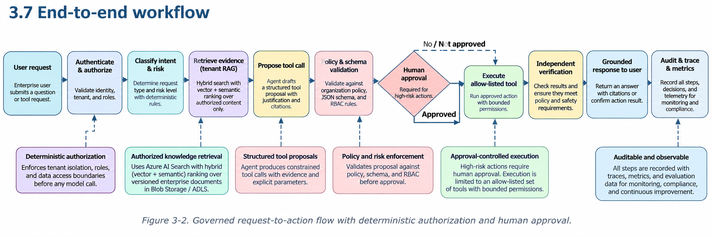

# NexusAgent AI

## What problem is solved?

Enterprise AI assistants must retrieve relevant information without crossing tenant boundaries, justify answers with verifiable evidence, and prevent autonomous actions from bypassing organizational policy. NexusAgent AI demonstrates governed agentic RAG with explicit authorization, grounded responses, bounded workflows, and human approval for sensitive operations.

## What is the architecture?

NexusAgent AI uses .NET 10, PostgreSQL 17, and pgvector. Its layered architecture separates API delivery, application orchestration, domain rules, infrastructure integrations, and background processing. The system combines document ingestion, hybrid retrieval, grounded-answer generation, policy evaluation, and durable workflow execution. The following diagram represents the target Microsoft Azure architecture, not an already deployed environment.

## What senior engineering problems were solved?

[Mandatory completion register](docs/architecture/completion-register.md).

**E2 - Offline AI inference:** Python/FastAPI and Ollama provide local
generation, grounded answers and 1536-dimensional semantic embeddings
through C# REST adapters without requiring Azure inference services.

Validated 19 Python tests, the existing 250-test .NET regression suite,
and live C#-Python-Ollama communication.
See [E2 architecture and local setup](docs/architecture/e2-offline-llm.md).

**E1 - Governed agent harness:** Typed execution contracts, bounded retries,
cooperative cancellation, workflow ownership verification, deny-by-default
authorization, scoped dependency injection and execution telemetry.

Validated **250 automated tests** across unit, architecture and integration
suites. See [E1 architecture documentation](docs/architecture/e1-agent-harness.md).

Validated 231 regression tests and PostgreSQL outbox isolation, including initialization-failure cleanup.

The implementation addresses tenant isolation, evidence-backed answer verification, prompt-injection defenses, transactional outbox reliability, durable workflow state, bounded execution, and approval-controlled actions. Production and Staging do not expose development-identity business endpoints, while database-readiness failures return HTTP 503 without leaking connection details. The final Release build passed all 231 automated tests: 117 unit, 3 architecture, and 111 integration.

**E3 - Governed multi-agent orchestration:** Supervisor, Policy,
Knowledge and Verifier agents execute through a bounded coordinator
with workflow ownership checks, hybrid PostgreSQL retrieval,
local Ollama inference and independent extractive citation verification.

See [E3 architecture and acceptance](docs/architecture/e3-multi-agent-orchestration.md).

**E4 - Durable agent execution:** PostgreSQL-backed agent memory,
bounded planning, transactional checkpoints, resumable execution,
lease fencing, idempotency, cancellation, evidence replay verification
and durable human approvals. Cumulative test coverage: 339 passing tests.
Outstanding verification is tracked in the completion register.

See [E4 architecture and acceptance evidence](docs/architecture/e4-durable-agent-execution.md).

## How can I run or inspect the demo?

Multi-agent execution is disabled by default and requires
explicit development opt-in: `Agents__EnableDevelopmentExecution=true`.

E3 corrective acceptance: 314 cumulative passing tests across
.NET and Python, including live local inference.

The local demo requires .NET 10, PostgreSQL 17 with pgvector, and configured Development database and document-storage settings. From the repository root, run these PowerShell commands:

    dotnet restore NexusAgent.slnx
    dotnet build NexusAgent.slnx
    dotnet run --project src/NexusAgent.Api

To run the complete automated test suite:

    dotnet test NexusAgent.slnx

The API exposes /health and /health/ready. Business endpoints are available only in Development. Application code is in src, automated tests in tests, Azure infrastructure definitions in infra/terraform, and operational procedures in docs/runbooks/production-operations.md. Azure deployment is not required for the local demo.
