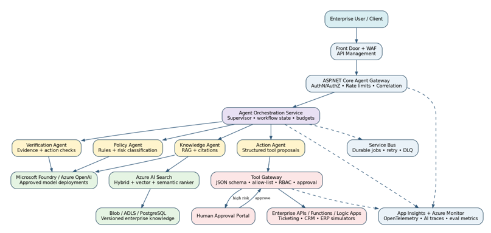

# NexusAgent AI

## What problem is solved?

Enterprise AI assistants must retrieve relevant information without crossing tenant boundaries, justify answers with verifiable evidence, and prevent autonomous actions from bypassing organizational policy. NexusAgent AI demonstrates governed agentic RAG with explicit authorization, grounded responses, bounded workflows, and human approval for sensitive operations.

## What is the architecture?

NexusAgent AI uses .NET 10, PostgreSQL 17, and pgvector. Its layered architecture separates API delivery, application orchestration, domain rules, infrastructure integrations, and background processing. The system combines document ingestion, hybrid retrieval, grounded-answer generation, policy evaluation, and durable workflow execution. The following diagram represents the target Microsoft Azure architecture, not an already deployed environment.

## What senior engineering problems were solved?

[Mandatory completion register](docs/architecture/completion-register.md).

**E2 - Offline AI inference:** Python/FastAPI and Ollama provide local
generation, grounded answers and 1536-dimensional semantic embeddings
through C# REST adapters without requiring Azure inference services.

Validated 19 Python tests, the existing 250-test .NET regression suite,
and live C#-Python-Ollama communication.
See [E2 architecture and local setup](docs/architecture/e2-offline-llm.md).

**E1 - Governed agent harness:** Typed execution contracts, bounded retries,
cooperative cancellation, workflow ownership verification, deny-by-default
authorization, scoped dependency injection and execution telemetry.

Validated **250 automated tests** across unit, architecture and integration
suites. See [E1 architecture documentation](docs/architecture/e1-agent-harness.md).

Validated 231 regression tests and PostgreSQL outbox isolation, including initialization-failure cleanup.

The implementation addresses tenant isolation, evidence-backed answer verification, prompt-injection defenses, transactional outbox reliability, durable workflow state, bounded execution, and approval-controlled actions. Production and Staging do not expose development-identity business endpoints, while database-readiness failures return HTTP 503 without leaking connection details. The final Release build passed all 231 automated tests: 117 unit, 3 architecture, and 111 integration.

**E3 - Governed multi-agent orchestration:** Supervisor, Policy,
Knowledge and Verifier agents execute through a bounded coordinator
with workflow ownership checks, hybrid PostgreSQL retrieval,
local Ollama inference and independent extractive citation verification.

See [E3 architecture and acceptance](docs/architecture/e3-multi-agent-orchestration.md).

**E4 - Durable agent execution:** PostgreSQL-backed agent memory,
bounded planning, transactional checkpoints, resumable execution,
lease fencing, idempotency, cancellation, evidence replay verification
and durable human approvals. Cumulative test coverage: 342 passing tests.
Outstanding verification is tracked in the completion register.

See [E4 architecture and acceptance evidence](docs/architecture/e4-durable-agent-execution.md).

**E4 delivery:** PR #8 merged into main with 342 passing regression tests.
Durable execution, checkpoint memory, bounded planning, retries,
cancellation and persistent approvals are implemented. Residual
acceptance requirements remain mandatory in E5 and E15.

**E4 completed (PR #10):** 348 passing tests, actual API-host crash recovery, delayed checkpoint rollback and replay cancellation verified. Cloud expenditure EUR 0.

**E5 progress:** Baseline audit, versioned evaluation dataset and automated evaluation framework and live hybrid retrieval benchmark and adversarial security acceptance completed (12 cases, 8 documents, 8 categories). AI evaluation, grounding and inference security implementation tracked in [E5 acceptance register](docs/architecture/e5-ai-evaluation-security.md).

**E5.6 completed:** Inference authentication verified. See the E5 acceptance register.

**E5.7 completed:** Concurrency, request limits and timeouts verified. See the E5 acceptance register.

**E5.8 completed:** Dependency warning remediation verified. See the E5 acceptance register.

**E5 acceptance:** 490 cumulative passing tests, including dedicated semantic relevance cutoff and safe candidate backfill regression. All benchmark and security holdout gates passed.

**E5 completed (PR #11):** AI evaluation, adversarial security, authenticated inference, resource controls and retrieval relevance validated locally. 490 cumulative passing tests. Cloud expenditure EUR 0.

### E6 - Java functional event processing

- E6.1 CLOSED: existing event contracts and Java environment audited.
- E6.2 CLOSED: pinned Maven wrapper and Java 21 build verified.
- E6.6 CLOSED: event integrity, deduplication and lifecycle validation; 66 Java tests passed.
- E6.7 security acceptance PASSED: 53 Java dependencies audited, zero OSV findings, 66 Java tests passed.
- E6.7 document wire interoperability PASSED: actual C# serialization consumed by Java.
- E6.7 CLOSED: document and workflow wire interoperability verified.
- E6 CLOSED (8/8): Java functional event processing, cross-language contracts and 576 regression tests passed; merged through PR #12.
- Architecture: [E6 implementation record](docs/architecture/e6-java-event-processing.md).

- E6.3 CLOSED: Spring Boot service foundation. 3 Java tests passed.

- E6.4 CLOSED: Immutable versioned event contracts. 26 Java tests passed.

- E6.5 CLOSED: Functional transformations and analytics. 40 Java tests passed.

- E7.1 CLOSED: digest-pinned Kafka KRaft infrastructure, explicit topics, publication, consumption and persistent replay verified.
- E7.2-E7.4 OPEN: durable event production, Kafka Streams and final acceptance.

- E7.2 progress: Kafka producer transport and partition-key validation implemented; transactional integration remains open.

- E7.2 progress: document publisher integrated with Kafka; live transport delivery verified.

- E7.2 progress: durable PostgreSQL workflow journal and transactional append foundation implemented.

- E7.2 progress: automatic transactional workflow lifecycle capture and rollback verified.

- E7.2 progress: EF workflow lifecycle migration applied and registered successfully.

- E7.2 progress: durable ordered workflow dispatch and broker failure recovery verified.

- E7.2: Event tenant capacity aligned across C#, Java and PostgreSQL.

- E7.2: Database publication safeguards and failure quarantine implemented.

- E7.2: Document predecessor ordering CLOSED; 18 targeted tests passed.

- E7.2: Rejection lifecycle, atomic approval association and automatic expiration verified; continuation, domain rejection tests and recovery acceptance remain open.

- E7.2 workflow-bound gateway CLOSED: PostgreSQL-backed single-use approval consumption, workflow and caller binding, concurrent invocation protection and replay rejection verified locally.

- E7.2: Durable approved-action continuation, transactional execution receipts and fail-closed recovery implemented; four database acceptance scenarios passed.

- E7.2: Unused approval expiration and durable claim interruption recovery verified; external tool process interruption acceptance subsequently passed.

- E7.2 workflow-bound execution and continuation CLOSED: actual .NET process interruption, durable recovery and replay rejection verified.

- E7.2 domain rejection lifecycle CLOSED: 18 dedicated domain acceptance cases, PostgreSQL lifecycle acceptance and related regressions passed.

- E7.2 CLOSED (11/11): durable C# event publication, workflow lifecycle governance, approval continuation and live Kafka publication recovery verified.

- E7.3.1 CLOSED: Kafka Streams 4.1.1 foundation, aligned dependencies, persistent state stores and 77 passing Java tests.

- E7.3.2 CLOSED: persistent production Kafka Streams topology and 89 passing Java tests.

- E7.3.3 checkpoint: persistent global identity registry implemented; 97 Java tests passed; production repartition integration pending.

- E7.3.3 CLOSED: production global identity registry, dual repartition boundaries and 104 passing Java tests.

- E7.3.4 CLOSED: persistent sequence buffering, ordered lifecycle processing and 112 passing Java tests.

- E7.3.5 CLOSED: persistent tenant-wide document, workflow, approval and duration analytics; compacted tenant snapshot topic; 131 passing Java tests.

- E7.3.6 CLOSED: live Kafka dead-letter acceptance, eleven rejection scenarios, source-coordinate verification, sensitive-data redaction, failure isolation and verified test resource cleanup; 132 passing Java tests.

- E7.3.7 CLOSED: live Kafka broker interruption recovery, aborted transaction isolation, fresh-directory changelog restoration, buffered sequence recovery and duplicate suppression; 133 passing Java tests.

- E7.3.8 checkpoint: 133 passing Java tests; consolidated streaming regression passed; six mandatory operational acceptance gates remain open.

- E738-01 CLOSED: forced JVM termination during an uncommitted Kafka Streams transaction, committed replay, duplicate suppression and restored tenant counters; 134 passing Java tests.

### Durable streaming gap monitoring

Pending-event observation timestamps survive Kafka Streams state restoration.
Targeted topology, observation and live recovery tests passed.
Live scheduled monitoring, overdue detection and resolved-gap acceptance passed. E738-02 is closed for instance-local monitoring.

See [E738 monitoring evidence](docs/architecture/e738-gap-monitoring-evidence.md).

### Auditable streaming reconciliation

Missing-predecessor events retain durable BUFFERED, RECONCILED or
REJECTED audit transitions. Recovery, duplicate suppression, corrected
successors and tenant isolation are verified. An internal tenant-scoped
audit reader supports bounded point lookups.

E738-03 acceptance is closed. Retention and migration safety are
addressed separately under E738-04.

### Streaming retention and acceptance safeguards

Source event retention is protected against time-based and size-based
expiry. Durable state policy validation rejects unsafe identity expiry
and unverified rebuilds.

UUID-scoped acceptance topic infrastructure provides owned-resource
cleanup. Synthetic snapshot classification preserves authoritative
tenants and prohibits prefix-only deletion decisions.

E738-04 through E738-06 remain open pending runtime integration,
isolated live acceptance and verified synthetic reconciliation.

### Integrated streaming acceptance

Broker-backed retention checks and isolated Kafka acceptance
scenarios passed 69 combined targeted tests.

Separate-JVM crash recovery uses dedicated topics and recovers
uncommitted processing boundaries without skipping source history.

A bounded snapshot inventory identified 20 historical synthetic
candidates among 50 observed tenant snapshots.

Historical migration verification and authorized reconciliation
remain open.

### Streaming acceptance isolation closure

E738-05 is formally closed following successful isolated
dead-letter, broker recovery and separate-JVM crash tests.

Historical source boundaries and authoritative tenant
references have been inspected and recorded.

E738-04 and E738-06 remain gated by authoritative historical
completeness and verified synthetic provenance respectively.

### Historical migration coverage safeguards

Historical coverage validation rejects unresolved publication
metadata, incomplete authoritative inventories and unsafe
migration evidence.

Legacy publication records with missing document-version
metadata remain explicitly unresolved. Authoritative migration
is not certified by retained Kafka offsets alone.

### Authoritative publication persistence

Document Kafka publications retain complete semantic wire
envelopes following acknowledged delivery.

Read-only inventory export and strict Java validation reject
incomplete historical migration evidence.

Targeted acceptance: 32 tests passed.

Crash-safe publication and successful authoritative migration
remain outstanding.

### Durable document publication intent

An immutable PostgreSQL journal persists document wire envelopes
before Kafka transmission and records acknowledgement separately.

Database immutability acceptance and 19 targeted C# tests passed.

Live document crash recovery and authoritative isolated migration
remain outstanding.

### Cross-language publication recovery and rebuild

Actual .NET publisher process termination, immutable PostgreSQL
publication recovery, exact Kafka retransmission and independent
Java Kafka Streams rebuild acceptance are verified.

Historical production migration remains fail-closed pending
complete legacy publication coverage.

### Historical recovery baseline

A versioned recovery-baseline candidate and fail-closed migration
policy preserve unresolved historical publication evidence.

Prospective cross-language rebuild acceptance is verified.
Production baseline migration and synthetic reconciliation remain
unauthorized until their independent evidence gates are satisfied.

### Production streaming recovery safeguards

Production startup validates committed source checkpoints and
durable changelog presence. Unverified application-ID changes
and automatic production offset resets are prohibited.

Historical malformed records and unverified synthetic snapshots
receive explicit preservation dispositions. Destructive
reconciliation and unverified historical migration remain denied.

### Controlled initialization and acceptance readiness

Pristine streaming environments require explicit initialization
approval. Established environments require durable checkpoints.

Acceptance fixtures create all dedicated topics before verifying
partition leaders, replica readiness and offset accessibility.

### Isolated recovery database initialization

The document publication crash probe provisions the database-local
pgvector extension before applying EF Core migrations. Fresh database
initialization verifies both pgvector and the durable publication journal.

### Verified prospective recovery baseline

The isolated recovery baseline exercises actual .NET publication
failure, durable recovery, exact Kafka history verification and
independent Java streaming materializations.

Fresh recovery databases provision pgvector before migrations.

Production publication inventory counts and Kafka boundaries are
preserved. Unverified historical migration remains prohibited.

The verified synthetic acceptance history is retained for
reproducible cross-language regression.

### Versioned streaming recovery generations

The Java streaming runtime supports explicitly bound legacy and
prospective generations with separate application identities and
Kafka topics.

Cross-generation topic bindings are rejected. Historical records
remain preserved, and automatic production cutover is prohibited.

The prospective namespace has a dedicated provisioning script.
Live runtime restoration and producer-routing integration remain
required before operational cutover.

### E7 generation-aware producer integration

- C# document and workflow publishers share generation-aware Kafka routing.
- Java and C# use `NEXUS_STREAM_GENERATION` with supported values `v1` and `v2`.
- The default remains `v1`; production cutover is not implicit.
- Unknown generations and physical topic overrides are rejected.
- Established stream applications require the expected repartition inventory.
- Release build and targeted routing and streaming regressions passed.
- Historical records and unverified acceptance resources remain preserved.
- Live operational recovery and formal E7 acceptance remain outstanding.
- Cloud expenditure: EUR 0.

### E7 prospective checkpoint initialization

- Missing checkpoints initialized only for pristine partitions.
- Active consumer groups and nonempty missing checkpoints rejected.
- Existing committed offsets preserved.
- Guarded prospective topology restart passed.
- Current-generation snapshot reader rejects legacy snapshot sources.
- Historical migration and production producer cutover not performed.
- Nonempty restoration and Spring lifecycle acceptance remain outstanding.
- Cloud expenditure: EUR 0.

### E7 Spring operational recovery

- Actual Spring-managed streaming lifecycle verified.
- Nonempty tenant state restored using a fresh local directory.
- Duplicate event replay preserved restored tenant counters.
- Current-generation snapshot export verified.
- Legacy Kafka partition boundaries preserved.
- Targeted Java regression: 41 passed, zero failed or skipped.
- Operational probe records retained in the prospective namespace.
- Historical migration and producer cutover not performed.
- Cloud expenditure: EUR 0.

### E7 operational checkpoint and export safeguards

- Reusable pristine-checkpoint preparation implemented and verified.
- Existing committed checkpoints preserved.
- Exact acceptance-tenant identities registered before publication.
- Registered acceptance snapshots excluded from operational exports.
- Spring lifecycle restoration and duplicate suppression verified.
- Java regression: 271 passed across the full suite and targeted corrective rerun.
- Combined failures, errors and skipped tests: zero.
- Previously unverified historical snapshots remain preserved.
- Cloud expenditure: EUR 0.

### E7 consolidated regression results

| Language | Passed | Failed | Skipped |
| --- | ---: | ---: | ---: |
| C# | 406 | 0 | 0 |
| Python | 151 | 0 | 0 |
| Java | 271 | 0 | 0 |
| Total | 828 | 0 | 0 |

- Release build passed with zero warnings and errors.
- Java results combine the full suite and targeted corrective rerun.
- Spring recovery, checkpoint preparation and cross-language rebuild verified.
- Registered acceptance identities excluded from operational exports.
- Historical migration and production cutover not performed.
- Final historical disposition and delivery closure remain pending.
- Cloud expenditure: EUR 0.

## How can I run or inspect the demo?

Multi-agent execution is disabled by default and requires
explicit development opt-in: `Agents__EnableDevelopmentExecution=true`.

E3 corrective acceptance: 314 cumulative passing tests across
.NET and Python, including live local inference.

The local demo requires .NET 10, PostgreSQL 17 with pgvector, and configured Development database and document-storage settings. From the repository root, run these PowerShell commands:

    dotnet restore NexusAgent.slnx
    dotnet build NexusAgent.slnx
    dotnet run --project src/NexusAgent.Api

To run the complete automated test suite:

    dotnet test NexusAgent.slnx

The API exposes /health and /health/ready. Business endpoints are available only in Development. Application code is in src, automated tests in tests, Azure infrastructure definitions in infra/terraform, and operational procedures in docs/runbooks/production-operations.md. Azure deployment is not required for the local demo.

### Authenticated local inference

Generate a strong session credential before starting either service.
Both Python and .NET must inherit the same NEXUS_INFERENCE_API_KEY
environment variable.

    $bytes = New-Object byte[] 32
    $rng = [Security.Cryptography.RandomNumberGenerator]::Create()
    try { $rng.GetBytes($bytes) } finally { $rng.Dispose() }
    $env:NEXUS_INFERENCE_API_KEY = [BitConverter]::ToString($bytes).Replace("-", "").ToLowerInvariant()

Start Python in a child process inheriting that environment:

    Start-Process powershell.exe -ArgumentList '-NoExit','-File','services/nexusagent-ai/Start-LocalInference.ps1'

The inference service binds to 127.0.0.1:8001 with one worker.
Do not commit credentials or expose the local service publicly.

E5 consolidated regression: 486 passing tests, eight benchmark
gates and eight security holdout cases.
