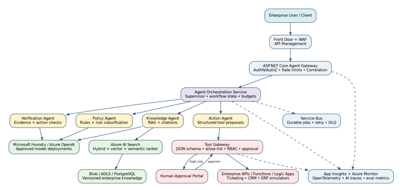
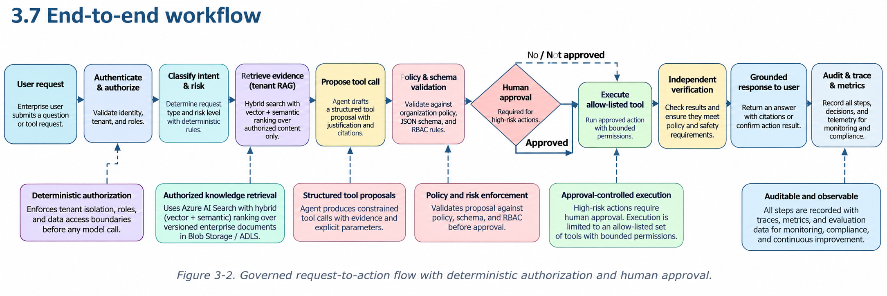

# NexusAgent AI

## What problem is solved?

Enterprise AI assistants must retrieve relevant information without crossing tenant boundaries, justify answers with verifiable evidence, and prevent autonomous actions from bypassing organizational policy. NexusAgent AI demonstrates governed agentic RAG with explicit authorization, grounded responses, bounded workflows, and human approval for sensitive operations.

## What is the architecture?

NexusAgent AI uses .NET 10, PostgreSQL 17, and pgvector. Its layered architecture separates API delivery, application orchestration, domain rules, infrastructure integrations, and background processing. The system combines document ingestion, hybrid retrieval, grounded-answer generation, policy evaluation, and durable workflow execution. The following diagram represents the target Microsoft Azure architecture, not an already deployed environment.

## What senior engineering problems were solved?

The implementation addresses tenant isolation, evidence-backed answer verification, prompt-injection defenses, transactional outbox reliability, durable workflow state, bounded execution, and approval-controlled actions. Production and Staging do not expose development-identity business endpoints, while database-readiness failures return HTTP 503 without leaking connection details. The final Release build passed all 231 automated tests: 117 unit, 3 architecture, and 111 integration.

## How can I run or inspect the demo?

The local implementation is organized in `NexusAgent.slnx`, with application code in `src`, automated tests in `tests`, Azure infrastructure definitions in `infra/terraform`, and recovery procedures in `docs/runbooks/production-operations.md`. The Development-only API can be explored using a configured local PostgreSQL database and document storage. The automated test projects provide an alternative way to inspect the system's behavior, authorization boundaries, and failure handling. Azure deployment and live operational drills remain outside the completed local portfolio scope.
